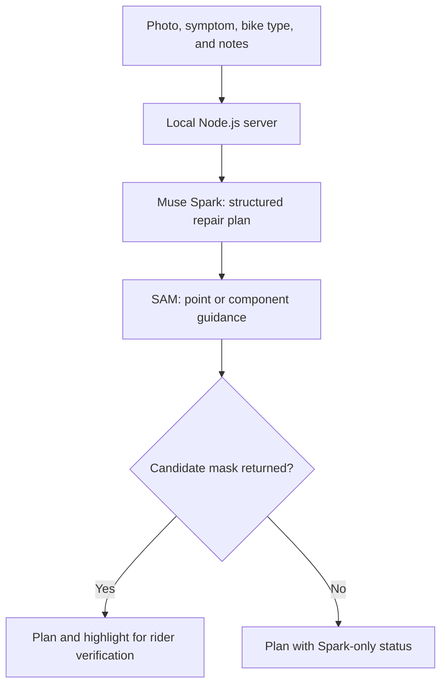

<div align="center">

# FixLens

### See the issue. Find the part. Take a safer next step.

A visual bicycle repair companion powered by **Meta Muse Spark 1.3** and **Meta SAM 3.1**.

**Photo + symptom → cautious repair plan + candidate part highlight**

[Explore the source](https://github.com/aditya052003/FixLens) · [Quick start](#quick-start) · [How it works](#how-it-works) · [Limitations](#safety-and-limitations)

Built by **Aditya Raut** for the **Meta Global AI Developer Hackathon**.

</div>

---

## Why FixLens?

A rider notices something wrong with their bicycle. They may know how it feels—“the tire looks soft” or “something is rubbing”—without knowing the component name or what to check next.

Searching for repair advice starts with knowing what to search for. Following that advice also requires locating the right part on the bicycle in front of you.

FixLens brings those two steps together. A rider uploads a photo, describes a symptom, and receives a structured plan alongside a candidate highlight of the relevant component. The rider verifies the highlight before using it as a visual reference.

**The goal is to help riders understand what to inspect and when to seek professional help.**

> **Prototype notice:** FixLens is not a mechanic or a safety certification. A photograph cannot confirm every fault, diagnose a hidden puncture, or prove that a bicycle is safe to ride.

## What you can do

| Capability | Rider experience |
| --- | --- |
| Describe the problem naturally | Upload a bicycle photo and provide the reported issue, bike type, and optional notes. |
| Receive a cautious repair plan | Muse Spark combines the photo and symptom to produce possible causes, practical checks, and safety guidance. |
| Locate a relevant component | SAM produces a candidate mask over the original photo. |
| Guide the highlight | Tap inside the intended part to guide segmentation. Without a tap, FixLens uses the component suggested by Spark and can retry with a broader part name. |
| Continue without a mask | The Spark repair plan remains available when SAM cannot return a highlight. |
| Know what actually ran | Explicit status labels distinguish a complete live model flow, Spark-only results, and example content. |

## Why two Meta models?

FixLens gives each model a distinct job in the rider's workflow.

- **Meta Muse Spark 1.3 — reason about the issue.** It uses the image and rider-provided context to generate a structured, cautious diagnosis and repair plan.
- **Meta SAM 3.1 — locate the component.** It returns a candidate segmentation mask using a rider-selected point or a component prompt.
- **The rider — verify the visual reference.** A plausible-looking mask can still select the wrong area. FixLens asks the rider to check the highlight.

The connection between reasoning and segmentation is the core interaction: **understand the reported issue, identify a part to inspect, and show where that part may be.** Segmentation is a visual aid; it does not validate the diagnosis.

## Try the demo

For a clear demonstration, choose a sharp photo showing the affected part and surrounding bicycle context. For a tire, include the wheel, tire, spokes, and some of the frame. Avoid extreme close-ups.

1. Upload the photograph.
2. Select the reported issue and bike type.
3. Add useful context in the optional notes.
4. Optionally tap the part you want to highlight.
5. Select **Diagnose my bike**.
6. Read the plan, check the candidate highlight, and review the safety guidance.

### Understand the result status

| Status | What it means |
| --- | --- |
| **LIVE · SPARK + SAM** | Spark returned a repair plan and SAM returned a candidate highlight. This does not establish that either result is correct. |
| **LIVE · SPARK** | Spark returned a repair plan, but SAM did not return a highlight. |
| **DEMO MODE** | The displayed plan is an example. It did **not** analyze the uploaded photograph. |

**Suggested demo walkthrough:** Show one live result, explain the highlighted component, demonstrate point guidance, and show how a Spark-only result still provides the plan when segmentation is unavailable. Use the visible status label to make clear what ran.

<!-- Add a real demo-video link and a screenshot of an actual live result here when available. Do not present demo-mode output as live inference. -->

## Quick start

### Requirements

- Windows with PowerShell
- Node.js **22.9 or newer**
- Internet access for dependency installation and live inference
- For live mode: a Meta Model API key with access and credits for the models used

### 1. Get the project

Download the repository ZIP and extract it, or clone it:

```powershell
git clone https://github.com/aditya052003/FixLens.git
cd FixLens
```

### 2. Explore the interface in demo mode

Double-click **`Open-FixLens-Demo.cmd`**, then wait for the browser to open:

```text
http://127.0.0.1:4173
```

The launcher starts the local server and installs the SAM parser dependency if needed. Without a Meta API key, the interface shows an example plan; it does not analyze your photo.

### 3. Run live analysis

1. Create a key in the Meta Model API dashboard.
2. Click **Copy** while the complete key is visible in its one-time dialog. The masked value in the keys list is not the full secret.
3. With the key on your clipboard, open PowerShell in the project folder and run:

```powershell
.\Start-FixLens.ps1
```

4. The launcher reads and validates the clipboard key, clears the clipboard, and starts the server. You do not need to paste the secret into a terminal command.
5. Keep the terminal open and visit:

```text
http://localhost:4173
```

**Run one launcher at a time.** If port `4173` is occupied by an existing FixLens server, stop it with **Ctrl+C** in its terminal before starting another.

If the clipboard does not contain the complete key, copy it again from the one-time dialog. If only a masked key remains available, create a replacement key.

## How it works



1. **Collect context.** The browser sends the selected image and rider-provided context to the local Node.js server.
2. **Generate the plan.** The server calls Muse Spark for a structured bicycle diagnosis and practical next steps.
3. **Request segmentation.** FixLens sends a point-guided or component-guided request to SAM 3.1.
4. **Decode the response.** The server uses Meta's `@meta-sam/parser` package to parse SAM's streamed mask response.
5. **Present the result.** The interface displays the repair plan, safety guidance, and any candidate mask, with a status label describing the available result.

Demo mode displays example content and is separate from this live inference flow.

## Engineering decisions

| Decision | Why it matters |
| --- | --- |
| Combine the photograph with the reported symptom | The image alone may not reveal the problem the rider is experiencing. |
| Support point guidance as well as component prompts | A rider can indicate the intended part when language or the image is ambiguous. |
| Allow a broader component-name retry | A more general part description provides another opportunity to obtain a useful mask. |
| Keep reasoning results when segmentation fails | A missing highlight does not discard an available repair plan. |
| Label live and example results explicitly | Riders and reviewers can see whether the uploaded photo was actually analyzed. |
| Keep API calls on the server | The Meta API key is not embedded in browser code. |
| Require human verification of the mask | Highlighting an object is not proof that it is the correct component or the cause of the fault. |

## Privacy and credentials

- The Meta API key stays on the local server side; it is not included in the browser page.
- The local app does not write uploaded photographs to disk.
- Live inference sends photographs to Meta's API. Local processing by the app does **not** mean that the entire inference flow is offline.
- Review Meta's current data policies before submitting sensitive images.
- Never put API keys in source files, commits, screenshots, videos, or support messages. Revoke any exposed key and create a replacement.

## Troubleshooting

| Problem | What to try |
| --- | --- |
| Browser cannot connect | Keep the launcher terminal open and check for `FixLens ready at http://localhost:4173`. |
| `EADDRINUSE` or port `4173` is busy | Stop the existing server with **Ctrl+C** in its terminal, then start one launcher. |
| `DEMO MODE` or “Example plan only” appears | Live analysis did not run. Start with a valid API key and confirm model access and project credits. |
| Launcher rejects the clipboard key | Copy the complete key from its one-time dialog. A masked key is insufficient. |
| Live request fails | Review the latest server error, confirm the key and model access, then restart the launcher. Remove secrets before sharing error details. |
| SAM returns no highlight | Try a wider, sharper photograph and tap clearly inside the intended component. The Spark repair plan may still be available. |

## Safety and limitations

FixLens supports initial understanding and inspection. It does not certify a repair or determine that a bicycle is safe to ride.

- **Both models can be wrong.** A plan may be incomplete, and a mask may highlight the wrong component.
- **Visible appearance is limited evidence.** Photographs cannot reliably establish tire pressure, hidden punctures, internal damage, or mechanical integrity.
- **Image quality affects results.** Occlusion, poor lighting, ambiguous parts, and extreme close-ups can reduce usefulness.
- **Live mode depends on external services.** API availability, model access, credits, and network connectivity affect the experience.
- **The scope is a hackathon prototype.** It focuses on common bicycle symptoms and is not a substitute for professional inspection.

Do not ride a bicycle with a flat or soft tire, visible damage, or an unresolved safety concern. When uncertain, stop and consult a qualified bicycle mechanic.

## Evaluation status

This README describes the prototype's workflow. It does not claim benchmarked diagnostic accuracy, validated repair outcomes, or measured safety improvements.

A useful next evaluation would use mechanic-reviewed bicycle cases and separately assess:

- Whether the plan addresses the reported symptom without claiming more than the evidence supports.
- Whether the candidate mask identifies the intended component.
- Whether uncertain and potentially unsafe cases receive appropriate escalation guidance.
- Whether demo mode, live mode, and segmentation failures are clearly communicated.

## Future work

These are proposed improvements, not current features:

- Mechanic-reviewed evaluation cases and published results.
- Follow-up questions when a single photograph is insufficient.
- Multiple photographs of the same issue.
- Clearer guidance for retaking ambiguous images.
- Broader accessibility and multilingual support.

## Built with

| Technology | Role |
| --- | --- |
| **Meta Muse Spark 1.3** | Image and symptom reasoning; structured repair plans |
| **Meta SAM 3.1** | Candidate component segmentation |
| **Meta `@meta-sam/parser`** | Decoding streamed SAM mask responses |
| **Node.js** | Local server and server-side Meta API calls |
| **HTML, CSS, JavaScript** | Browser interface and result presentation |
| **PowerShell and Windows command scripts** | Local launch workflow |

## Author

**Aditya Raut** · [GitHub](https://github.com/aditya052003)

Built for the **Meta Global AI Developer Hackathon**.

[View the FixLens repository](https://github.com/aditya052003/FixLens)

---

**See the issue. Find the part. Take a safer next step.**
